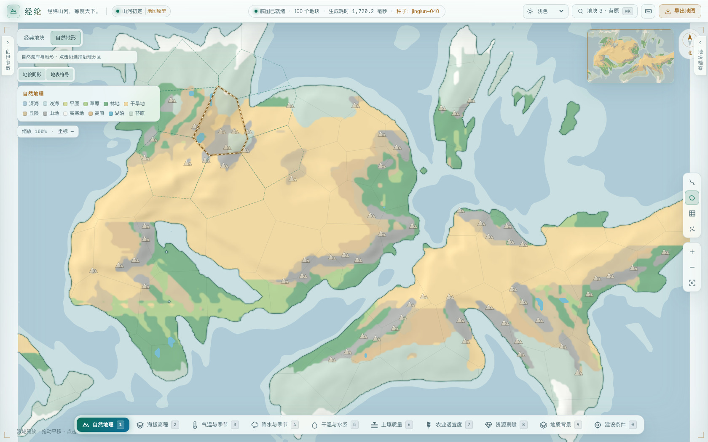
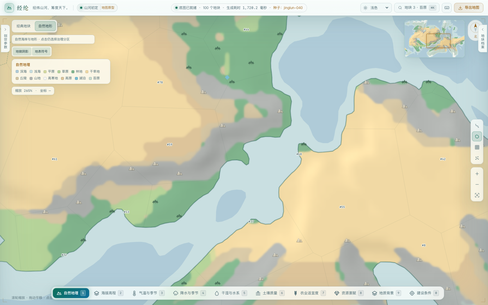
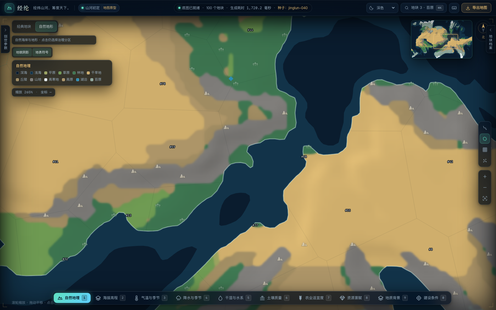
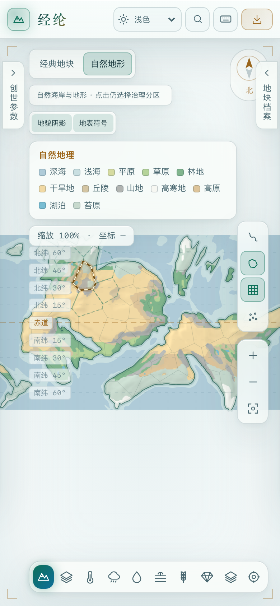
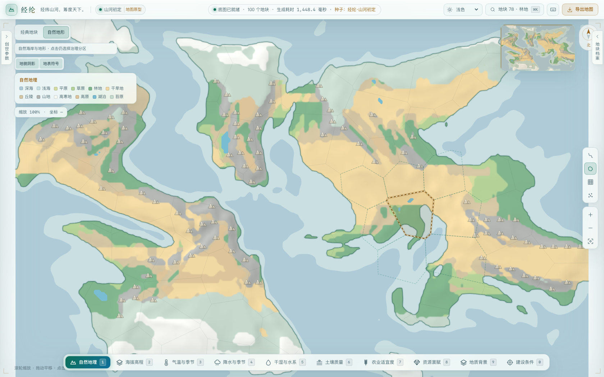

# 第二阶段验收：静态地形质感与缩放分级

日期：2026-10-23。基线 `67bcf0f`（Phase 1）。在独立临时工作副本实现，不切换或修改用户原工作目录。以下为本机结果，不是 GitHub CI，也不是全浏览器/全设备保证。

## 上游 develop 适配复核

2026-10-23，0.9.0：作者 `develop` 从 `ea8de64` 推进到 `9194d47b497458360f907a5fd96135b63f526d42`，含 0.8.0 温度和构造、0.9.0 海温与洋流。重新合入后，解决 `environment.rs`、`lib.rs`、`frontend/src/map.ts` 的导入/模块冲突，以及 `docs/MAP.md` 的章节追加冲突。保留作者全部新模块、海温取值和版本检查，不改变气候、构造或洋流算法。

新组合独立通过 43 项 Rust 测试、29 项前端测试、TypeScript、生产构建与差异检查。1 项手动多种子报告按上游默认设置忽略。另对原版 `9194d47` 与合入版使用同一 `jinglun-040 / 100 / 2 / 0.45` 配置各自运行 Rust 生成器，删除新增 `environment.natural_surface` 后完整 JSON 深相等，canonical SHA-256 为 `846a9f764ed1011b3bc56b81e9dbe03b51a726cae21a4c370a685ff411220b57`。新增 natural_surface 为 537,034 字节。固定源码树与结果见 [0.9.0 字段一致性记录](natural-map-phase2/develop-0.9-invariance.json)。此对照仅覆盖该固定配置，本次未重跑完整浏览器验收；下文 0.6.0 截图不代表 0.9.0 的地图输出。

2026-10-23：上游 PR #2 的目标纠正为作者的 `develop`，基线为 `ea8de640d30044ba6a54f3fbc7dbac767541ffba`，生成器为 0.7.0。通过追加合并提交保留作者的二维月度气候与季风代码，只解决 `environment.rs` 与 `lib.rs` 的新增 import/module 声明冲突，没有改动两边算法。

适配后独立复跑：Rust 34 项通过，1 项手动多种子报告按上游默认设置忽略；前端 28 项通过；TypeScript、生产构建与差异检查通过。本次未重新执行全部浏览器场景，也未重跑 0.7.0 原字段逐项对照。下文截图、响应大小、字段一致性和浏览器记录保留原 0.6.0 基线的历史含义，不能将旧截图当作新气候输出。

## 实现与测试

- `cargo test --workspace`：30 项通过（29 内核 + 1 服务接口）。新增 3 项验证平地/水面中性、坡向与西北光源关系、符号来源与确定性。
- `npm run test:web`：28 项通过。新增 8 项验证数据校验、像素覆盖/无裂缝、颜色/阴影开关、非修改性、边界权重、屏幕 LOD 与标注密度。
- `npm run build`：TypeScript 与 Vite production build 通过。没有修改 package.json / lockfile 或新增依赖。
- `git diff --check`：通过。

## 模型不变

固定 `jinglun-040`、100 地块、2 次松弛、45% 陆域，对照运行中的 Phase 1 后端。排除新增 `environment.natural_surface.detail` 和非确定性的响应 meta，原始 map JSON 逐字段完全一致。自然海岸、浅海、原始类别路径、治理区、邻接、水文与矿产均未改变。

新增 detail 的紧凑 JSON 为 257,064 字节；本例未压缩响应由约 6.35 MB 增到约 6.61 MB。该例阴影编码范围为 113—140（128 中性），地表符号候选 146 个。详见 [机器记录](natural-map-phase2/model-invariance.json)。

100 / 500 / 2,000 地块的整个 natural_surface（包含新增 detail）SHA-256 一致；它不跟随治理分区数量改变。

## 浏览器检查

Chromium 153，本机实际后端生成数据。既有 [回归脚本](../../scripts/check-natural-map.mjs) 验证 100/500/2,000 地块下经典/自然点击、相机、选区、候选列表、小地图、拖动缩放、河网 GPU↔SVG 生命周期、月份、主题、专题回退、重新生成与无额外生成请求。三组经典河网均实际进入 GPU。

新增 [第二阶段脚本](../../scripts/check-natural-map-phase2.mjs) 验证：

- 阴影开关改变主图与小地图，但不改变视野/选区；切回恢复缓存纹理。
- 远景不显示地块编号；放大后显示有实际来源的山地、森林符号与原始地块 ID。
- 地表符号开关可清空/恢复符号和编号；专题图层不残留地形符号。
- 深浅主题、专题往返保留阴影选择；上述交互只发生一次世界生成。
- 拖动缩放不更换静态纹理，不启动新的绘图 ticker。
- Phase 1 响应不含 detail 时自然 SVG 正常；Canvas getContext 返回 null 时也正常回退。
- 390×844 / DPR2 下控件可见、无横向溢出、远景符号不拥挤。
- 第二个种子「经纶·山河初定」可正常显示。

[既有交互回归结果](natural-map-phase2/regression-check.json) · [第二阶段控制与降级结果](natural-map-phase2/detail-check.json)。两份记录 page/console errors 均为空。

## 实际截图

第一阶段同一 seed 的参考见 [Phase 1](natural-map-phase1/natural-100.png)。本阶段截图来自真实页面，不是效果图。高倍缩放下可以看到源分辨率限制，不能把平滑纹理当成新增地理精度。

### 第二阶段全图


### 放大细节：地形符号与治理区编号


### 深色


### 窄屏


### 另一种子


## 重跑

按 README 启动本分支前后端后，使用独立安装的 Playwright：

```sh
BASE_URL=http://127.0.0.1:5173 PLAYWRIGHT_MODULE=/absolute/path/to/playwright/index.mjs \
  ARTIFACT_DIR=.cache/phase2-regression node scripts/check-natural-map.mjs
BASE_URL=http://127.0.0.1:5173 PLAYWRIGHT_MODULE=/absolute/path/to/playwright/index.mjs \
  ARTIFACT_DIR=.cache/phase2-detail node scripts/check-natural-map-phase2.mjs
```

Playwright 不进入游戏运行依赖；使用普通测试/构建不需要安装浏览器。

## 仍有的边界

未覆盖 Safari/Firefox、低端移动设备实际性能、长期内存压力或全部种子。没有声称固定帧率或专业美术验收。内部类别用局部权重做显示概括，窄小地形斑块的可见面积可能变化；海岸与湖泊路径不变，模拟分类和面积统计不变。图例表示主导类别而非纹理中每一种混合色。

尚无正式地名/国家/设施模型，因此不创建城市、首都、矿山、国界和资源设施标注。自然视图依然使用 SVG 河网；政治覆盖与真实业务图层不属于本阶段。
