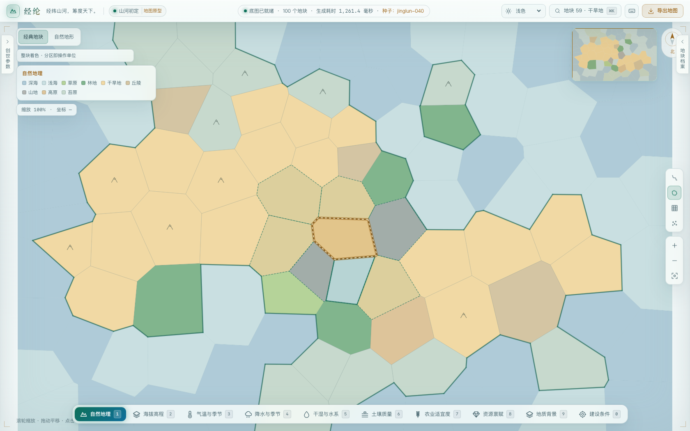
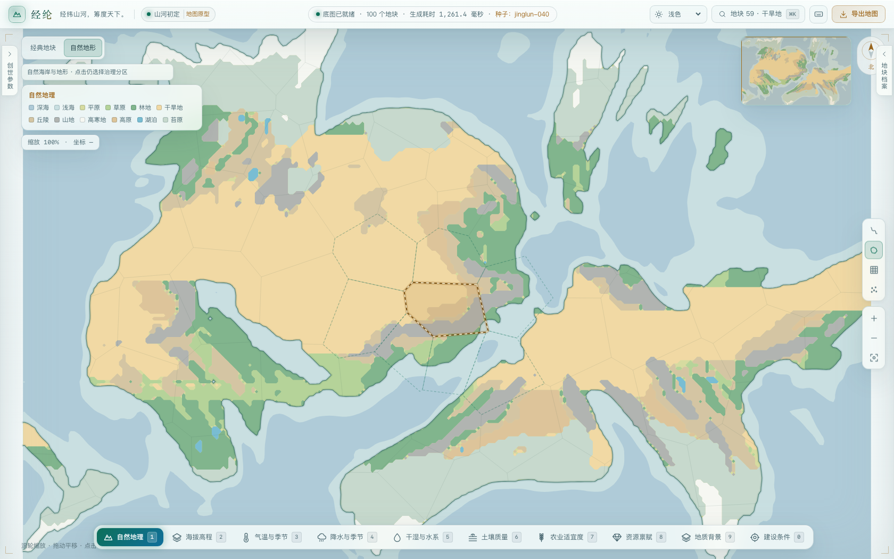

# 自然地图 Phase 1：实现与验收

2026-10-23。本次基于本 Fork 的 `Develop@69f86cdc1014233c623663a36bc3801ba88cc218`，没有更新 `main`、`Develop` 或上游仓库。实现与浏览器验收在独立 checkout 完成。

## 看效果

运行原有 `npm run dev`，点击地图左上角「自然地形」。默认仍为「经典地块」。选择地形图层才能看到自然底图；资源、气候等专题保持整块汇总。下面两张图来自真实运行界面，同一 seed、100 个分区、相同视野与选区，不是概念图。

### 经典地块



### 自然地形



另有 [500 地块](natural-map-phase1/natural-500.png)、[2,000 地块](natural-map-phase1/natural-2000.png)、[深色与河网](natural-map-phase1/natural-dark-100.png)、[390px 窄屏、2× DPR](natural-map-phase1/natural-mobile-100.png)。

## 实际完成

Rust 从原高程场提取自然海岸与浅海轮廓，并输出原地形类别的表现路径。SVG 自然底图、透明治理区点击层、淡化行政边界、自然陆域裁剪、同步小地图和视图开关已接入。经典模式保留，旧后端数据缺少表现字段时显式回退。

自然模式使用 SVG 河网；经典模式保留 PixiJS，包括原有异步加载和降级路径。没有新增 runtime 依赖，没有 WASM、3D、Hillshade、国家模拟或新美术素材。

## 实测证据

- `cargo test --workspace`：27 项通过（26 项世界内核、1 项服务接口），含 5 项新增轮廓测试：满/空场、边界、线性插值、孔洞、鞍点、对角接触、等值退化。
- `npm run test:web`：20 项通过，含新增模式解析及主图/小地图共用绘制计划测试。
- `npm run build`：TypeScript 检查和 Vite production build 通过。`git diff --check` 通过。
- Chromium 153.0.8010.12：100 / 500 / 2,000 地块均完成实际点击（经典和自然各一次）、缩放拖动、视图往返、选区/相机保留、小地图更新、月度/专题保留、主题切换、河网 GPU ↔ SVG 生命周期检查。100 地块还验证候选列表保留，500 地块验证重新生成后自然模式保留。三组经典河网均实际进入 GPU 状态。
- 390 × 844、DPR=2：自然视图与切换按钮可见，无横向页面溢出。旧后端响应移除新增字段后，仍能安全显示经典视图。
- 浏览器采集的 page errors 和 console errors 均为空。切换表现没有触发额外世界生成请求。

完整机器记录：[浏览器检查](natural-map-phase1/browser-check.json)。本轮是 Chromium 本机验收，不代表 Safari / Firefox、所有种子或所有设备均已验证；不作 FPS 或性能提升承诺。

## 世界没有被偷偷重算

对 `jinglun-040 / 100 / 2 次松弛 / 45% 陆域`，将改动前基线服务的 JSON 与新服务逐字段对比。只排除新增 `environment.natural_surface` 和响应的非确定性耗时 `meta`，所有原始 `map` 字段完全相等。

同一 seed 下 100 / 500 / 2,000 分区的自然表现字段 SHA-256 完全相同：

```
da6e15432d7bd05d06eff14d4e5f360d5947553c2a6e0584515cbf50d57ec245
```

原字段 canonical SHA-256 为 `adbad185adb3ab9b9a726062274f06edd2907736e64886b660c72e3a1b68e892`。本案例原响应约 6.11 MB，新响应约 6.35 MB，表现字段约 240 KB；不是精简数据传输的改动。[完整一致性记录](natural-map-phase1/model-invariance.json)。

## 可复跑

正常启动本分支前后端后：

```sh
npm run build
npm run test:web
cargo test --workspace
# 可选浏览器验收：环境须已安装 Playwright 和 Chromium。
BASE_URL=http://127.0.0.1:5173 node scripts/check-natural-map.mjs
```

浏览器脚本默认从 `playwright` package 载入，也可通过 `PLAYWRIGHT_MODULE` 指向已经安装的 `playwright/index.mjs`。它是可选 QA 依赖，未加入游戏依赖或默认测试链。默认输出到 `.cache/natural-map-qa`，可用 `ARTIFACT_DIR` 指定证据目录。对大响应通过 route.fetch 捕获完整 JSON，避免 DevTools response cache 的容量限制；旧后端回退场景才特意删除新增字段。

## 当前观感与剩余限制

海岸、海湾、岛屿和浅海已不再跟随管理地块的折线；区划数量减少也不再降低自然轮廓的细节。视觉复核已查看浅色、深色与窄屏画面。

内部地形类别仍有 256 × 160 采样带来的折线与块状感，这是本次原型尚未解决的美术问题。后续应单独评估地形类别边界概括、真实高程阴影和统一符号，不能把换渲染引擎当成自动美化。自然地图不是更高精度的模拟；完整分区高亮跨越海陆，是既有混合治理区的真实边界。

[设计提案与阶段边界](../proposals/2026-10-23-natural-map.md)。本记录表示第一阶段工程及所列验收完成，不代替用户对最终美术方向的确认。
